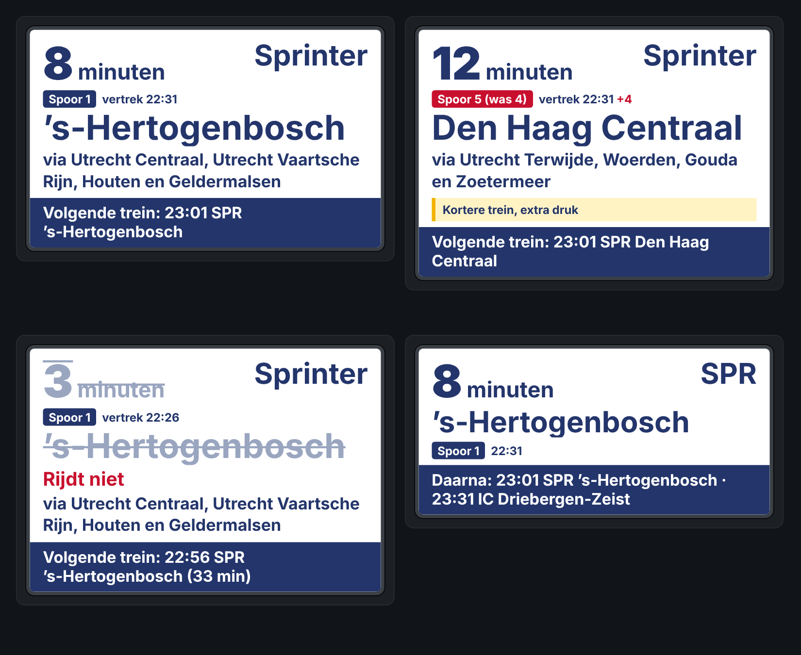

# NS Vertrekbord Card

A Lovelace card that shows an [NS vertrekbord](https://github.com/nosehook/ns-vertrekbord) sensor as a Dutch station departure board: big minutes until departure, train type, final destination, via stations, track (track changes in red), delays, cancellations ("Rijdt niet"), NS messages and the next train in a blue bar.



## Features

- Normal, delayed (with `+4` and track change), cancelled and compact layouts.
- Long station names such as *'s-Hertogenbosch* stay on one line.
- Counts down locally between updates; "Vertrekt nu" when the train is due.
- When the first train is cancelled, the bar shows the next train that does run.
- Visual editor; Dutch and English labels.

## Requirements

The [NS vertrekbord](https://github.com/nosehook/ns-vertrekbord) integration.

## Installation

[](https://my.home-assistant.io/redirect/marketplace_repository/?owner=nosehook&repository=ns-vertrekbord-card&category=plugin)

<!-- ha-marketplace:exclude-start -->
### Marketplace (Home Assistant 2026.11 and later)
1. Click the button above, or open the **Marketplace** and add `https://github.com/nosehook/ns-vertrekbord-card` by its link, category **Dashboard**.
2. Install **NS Vertrekbord Card** and reload your browser.

### HACS (Home Assistant before 2026.11)
Add `https://github.com/nosehook/ns-vertrekbord-card` as a custom repository, category **Dashboard**, and install.

### Manual
1. Copy `ns-vertrekbord-card.js` to `/config/www/`.
2. Settings → Dashboards → ⋮ → Resources → add `/local/ns-vertrekbord-card.js` as a **JavaScript module**.
<!-- ha-marketplace:exclude-end -->

## Configuration

```yaml
type: custom:ns-vertrekbord-card
entity: sensor.utrecht_leidsche_rijn_utrecht_centraal_vertrek_over
```

| Option | Default | Description |
|---|---|---|
| `entity` | – | The *Vertrek over* sensor of an NS vertrekbord |
| `compact` | `false` | Smaller layout without the via line |
| `show_via` | `true` | Show the via stations |
| `show_messages` | `true` | Show NS messages (yellow bar) |
| `show_track` | `true` | Show the track |
| `next_count` | `1` (`2` compact) | Next trains in the bottom bar (`0` hides it) |
| `type_style` | `auto` | `long` (Sprinter), `short` (SPR) or `auto` |
| `language` | `nl` | `nl` or `en` |

Not affiliated with or endorsed by NS.

## License

MIT
